# Yojsetu — Entity-Relationship (ER) Diagram

Production Relational Schema Specification for MySQL and SQLite.

---

## Entity-Relationship Diagram

```mermaid
erDiagram
    users ||--o{ otp_verifications : "authenticates / requests OTP"
    users ||--o| citizen_profiles : "has"
    users ||--o{ applications : "submits"
    users ||--o{ user_documents : "uploads"

    schemes ||--o{ scheme_rules : "defines"
    schemes ||--o{ scheme_documents : "requires"
    schemes ||--o{ applications : "receives"

    users {
        int id PK "AUTO_INCREMENT"
        varchar full_name "NOT NULL"
        varchar email "UNIQUE"
        varchar phone "UNIQUE, NOT NULL"
        varchar password_hash "NOT NULL"
        boolean is_phone_verified "DEFAULT TRUE"
        boolean is_email_verified "DEFAULT FALSE"
        varchar role "DEFAULT 'citizen'"
        boolean is_active "DEFAULT TRUE"
        boolean onboarding_complete "DEFAULT FALSE"
        datetime created_at "DEFAULT CURRENT_TIMESTAMP"
        datetime updated_at "AUTO UPDATE"
    }

    otp_verifications {
        int id PK "AUTO_INCREMENT"
        int user_id FK "REFERENCES users(id) ON DELETE CASCADE"
        varchar phone "NOT NULL"
        varchar otp_hash "NOT NULL"
        varchar purpose "DEFAULT 'REGISTER'"
        datetime expires_at "NOT NULL"
        int attempts "DEFAULT 0"
        boolean verified "DEFAULT FALSE"
        datetime created_at "DEFAULT CURRENT_TIMESTAMP"
    }

    citizen_profiles {
        int id PK "AUTO_INCREMENT"
        int user_id FK "UNIQUE, REFERENCES users(id) ON DELETE CASCADE"
        varchar full_name
        varchar date_of_birth
        int age
        varchar gender
        varchar state
        varchar district
        varchar block
        varchar village_city
        varchar pincode
        varchar rural_urban "DEFAULT 'Rural'"
        decimal annual_income "DEFAULT 0.00"
        varchar occupation
        varchar education
        varchar social_category "DEFAULT 'General'"
        varchar marital_status
        int family_size "DEFAULT 1"
        int children_count "DEFAULT 0"
        varchar disability_status "DEFAULT 'No'"
        float disability_percentage
        varchar bpl_status "DEFAULT 'No'"
        minority_status varchar "DEFAULT 'No'"
        varchar housing_status
        text raw_details
        datetime created_at "DEFAULT CURRENT_TIMESTAMP"
        datetime updated_at "AUTO UPDATE"
    }

    schemes {
        int id PK "AUTO_INCREMENT"
        varchar external_scheme_id "UNIQUE, NOT NULL"
        varchar name "NOT NULL"
        text description
        text benefits
        varchar category
        varchar government_level "DEFAULT 'Central'"
        varchar state "DEFAULT 'All India'"
        varchar department
        varchar source_url
        varchar source_name "DEFAULT 'MyScheme Portal'"
        varchar application_url
        varchar application_method "DEFAULT 'Online'"
        varchar status "DEFAULT 'Active'"
        datetime last_updated "DEFAULT CURRENT_TIMESTAMP"
        datetime created_at "DEFAULT CURRENT_TIMESTAMP"
    }

    scheme_rules {
        int id PK "AUTO_INCREMENT"
        int scheme_id FK "REFERENCES schemes(id) ON DELETE CASCADE"
        varchar field_name "NOT NULL"
        varchar operator "NOT NULL"
        varchar field_value "NOT NULL"
        boolean is_mandatory "DEFAULT TRUE"
        text raw_condition_text
    }

    scheme_documents {
        int id PK "AUTO_INCREMENT"
        int scheme_id FK "REFERENCES schemes(id) ON DELETE CASCADE"
        varchar document_name "NOT NULL"
        boolean is_mandatory "DEFAULT TRUE"
        text description
    }

    applications {
        int id PK "AUTO_INCREMENT"
        varchar application_id "UNIQUE, NOT NULL"
        int user_id FK "REFERENCES users(id) ON DELETE CASCADE"
        int scheme_id FK "REFERENCES schemes(id) ON DELETE SET NULL"
        varchar external_scheme_id "NOT NULL"
        varchar status "DEFAULT 'planning'"
        datetime submission_date
        datetime applied_date
        text metadata
        datetime created_at "DEFAULT CURRENT_TIMESTAMP"
        datetime updated_at "AUTO UPDATE"
    }

    user_documents {
        int id PK "AUTO_INCREMENT"
        varchar document_id "UNIQUE, NOT NULL"
        int user_id FK "REFERENCES users(id) ON DELETE CASCADE"
        varchar document_type "NOT NULL"
        varchar document_name "NOT NULL"
        varchar file_path
        int file_size
        varchar mime_type
        varchar verification_status "DEFAULT 'pending'"
        text metadata
        datetime uploaded_at "DEFAULT CURRENT_TIMESTAMP"
        datetime created_at "DEFAULT CURRENT_TIMESTAMP"
        datetime updated_at "AUTO UPDATE"
    }
```

---

## Relationship Details

1. **`users` 1:N `otp_verifications`**:
   - `otp_verifications.user_id` is an optional foreign key referencing `users(id)`.
   - Used for verifying phone registration or account reset.
   - Deletion of a user cascades to their OTP records.

2. **`users` 1:1 `citizen_profiles`**:
   - `citizen_profiles.user_id` has a `UNIQUE` constraint referencing `users(id)`.
   - Ensures strict multi-user data isolation.
   - Deletion of a user cascades to their profile.

3. **`users` 1:N `applications`**:
   - Tracks scheme applications initiated, saved, or submitted by the authenticated citizen.
   - Tied to `users.id` with `ON DELETE CASCADE`.

4. **`users` 1:N `user_documents`**:
   - Metadata for uploaded verification documents (e.g. Aadhaar Card, Electricity Bill, Income Certificate).
   - Actual files are stored on disk or object storage, referenced via `file_path`.
   - Tied to `users.id` with `ON DELETE CASCADE`.

5. **`schemes` 1:N `scheme_rules`**:
   - Eligibility conditions for a scheme evaluated by the eligibility rules engine.
   - Cascades when a scheme is removed.

6. **`schemes` 1:N `scheme_documents`**:
   - Required / optional supporting documents required for applying to a scheme.
   - Cascades when a scheme is removed.

7. **`schemes` 1:N `applications`**:
   - Tracks which scheme an application targets (`scheme_id` foreign key).
   - Set to NULL if scheme record is archived, preserving application history.
